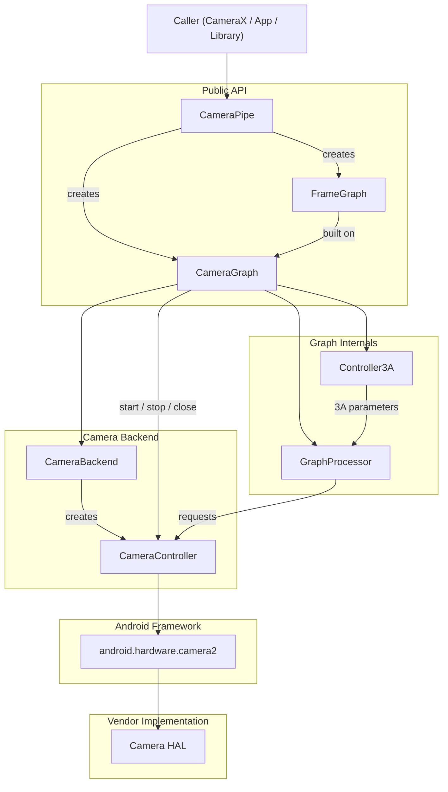

# Project: CameraPipe (camera-camera2-pipe)

CameraPipe is a low-level, high-performance Camera2 abstraction layer built from the ground up to be
idiomatic to Kotlin. It provides a flexible, asynchronous, and resilient shim to power
high-performance camera applications and serves as the backend for CameraX's `camera-camera2`
implementation.

## High-Level Architecture

CameraPipe is organized into distinct layers between caller code and the Android camera stack:



### Thread Safety & Non-Blocking API

- **Thread-safe & non-blocking by default**: CameraPipe's public API surface is designed to be
  thread-safe and non-blocking — operations return immediately or suspend while offloading work to
  CameraPipe's managed thread pools (`Threads`).
- **Main-thread safe, background-thread ready**: Because public APIs do not block the calling
  thread, they are **main-thread safe** (safe to call directly from the UI thread). At the same
  time, callers are **not** required to invoke them from the main thread — the API is explicitly
  designed to be usable from background threads and arbitrary coroutine contexts.
- **Explicit blocking exceptions**: Methods that may block the calling thread are explicitly
  indicated (e.g., synchronous compatibility `await*()` methods on `CameraDevices` /
  `CameraMetadata` / `CameraBackend`, or methods suffixed with `*Blocking`).

### Core Abstractions

- **CameraPipe**: The top-level entry point for all interactions with Android cameras. A single
  `CameraPipe` instance owns shared thread pools (`Threads`), `CameraMetadata` caches, and
  `CameraBackend` instances — callers should keep **one instance per process**. It provides APIs to
  query and control available cameras (`CameraPipe.cameras()`), create capture graphs
  (`CameraPipe.createCameraGraph`, `CameraPipe.createFrameGraph`, `createCameraGraphs`,
  `createFrameGraphs`), query stream combination support (`isConfigSupported`,
  `prewarmIsConfigSupported`), control global audio restrictions (`globalAudioRestrictionMode`), and
  release global resources (`shutdown()` — terminal and blocking; avoid calling it from a CameraPipe
  thread since it blocks on `cameraPipeJob.cancelAndJoin()` and shuts down CameraPipe's executors).
- **CameraDevices**: Returned by `CameraPipe.cameras()`. Provides camera discovery, metadata lookup,
  and active device lifecycle controls, backed by `Camera2DeviceCache` (for camera ID lists),
  `Camera2MetadataCache` (for `CameraMetadata`), and `Camera2DeviceManager` (for prewarming,
  opening, and closing hardware cameras).
  - **Method naming convention**: `get*()` (`getCameraIds()`, `getConcurrentCameraIds()`,
    `getCameraMetadata()` on `CameraDevices`; `getPhysicalMetadata()`, `getExtensionMetadata()` on
    `CameraMetadata`) is `suspend`; `await*()` (`awaitCameraIds()`, `awaitConcurrentCameraIds()`,
    `awaitCameraMetadata()`, and `CameraMetadata.awaitPhysicalMetadata()` /
    `awaitExtensionMetadata()`) is a non-suspending synchronous blocking compatibility API that
    queries `CameraManager` on the calling thread on a cache miss; `disconnect*()` is
    fire-and-forget while `disconnect*Async()` starts asynchronously and returns a `Deferred<Unit>`
    immediately without suspending. (`findAll()`, `ids()`, `getMetadata()`, and `awaitMetadata()`
    are deprecated.)
  - **Prewarming**: `CameraDevices.prewarm(cameraId)` opens an `ActiveCamera` in
    `Camera2DeviceManager` with a 1-second idle `WakeLock` timeout (`timeout = 1.seconds`,
    `startTimeoutOnCreation = true`) and immediately releases its token; if no graph connects within
    1 second, CameraPipe closes the underlying device automatically.
- **CameraGraph**: Represents the combined configuration and state of a single configured camera
  (implementing `CameraGraphBase<CameraGraph.Session>` and `CameraControls3A`). Unlike a raw
  `CameraCaptureSession`, the caller declares the camera ID, streams, templates, parameters, and
  listeners upfront in `CameraGraph.Config`, and the `CameraGraph` outlives the underlying
  `CameraDevice` and capture session as CameraPipe opens, reconfigures, and retries them.
  - During `CameraGraph` creation (`CameraGraphComponent`), `CameraGraph` calls `CameraBackend` to
    create a `CameraController` (`Camera2CameraController`).
  - Creating a graph does **not** open the camera hardware. Calling `start()` returns immediately
    and asynchronously opens the camera; `stop()` pauses the graph; `close()` permanently tears it
    down. `start()`, `stop()`, and `close()` are forwarded to `CameraController`.
  - Surfaces (`setSurface(streamId, surface)`), parameters (`graph.parameters`), and requests can be
    configured before or after `start()`. When the capture session is recreated (e.g., on surface
    changes or transient error recovery), `GraphProcessor` and `Controller3A` automatically replay
    the repeating request, `graph.parameters`, and 3A state.
- **CameraGraph.Session**: A short-lived, **non-reentrant** coroutine mutex lock (`acquireSession()`,
  `acquireSessionOrNull()`, `useSession {}`, `useSessionIn(scope) {}`) that grants exclusive access
  to mutate the repeating request (`startRepeating`, `stopRepeating`), submit capture bursts
  (`submit`), abort in-flight captures (`abort`, which stops the active repeating request while
  keeping a copy in `session.repeatingRequest` so the previous repeating request can later be
  restarted), or invoke session-locked 3A operations (`lock3A`, `unlock3A`, `lock3AForCapture`,
  `unlock3APostCapture`).
  - **Session invariants**:
    1. Never acquire a session inside another session on the same coroutine (deadlocks on the
       non-reentrant mutex).
    2. Keep session blocks short and non-blocking; when calling session 3A methods (which are
       `suspend` and return `Deferred<Result3A>` once the request is queued), await the returned
       `Deferred` **outside** `useSession {}` so the session lock is not held across frame
       convergence.
    3. `CameraGraph.Session` has **no** `capture(...)` method — `capture(...)` exists only on
       `FrameGraph` and `FrameGraph.Session`.
- **FrameGraph**: Wraps a `CameraGraph` (`FrameGraphImpl`) and synchronizes per-frame `FrameInfo`
  (`TotalCaptureResult`) and `OutputImage`s into reference-counted `Frame` objects (`FrameState` /
  `FrameDistributor`).
  - **Image delivery requires `ImageSourceConfig`**: `FrameGraph` only delivers `OutputImage`s for
    streams whose `CameraStream.Config` sets `imageSourceConfig = ImageSourceConfig(capacity = ...)`,
    which backs the stream with a CameraPipe-managed `ImageSource` (default: `ImageReaderImageSource`
    wrapping `AndroidImageReader` / `AndroidMultiResolutionImageReader`). `ImageSource` defers
    closing the underlying `ImageReader` until all outstanding `OutputImage`s are closed, and closes
    incoming images (passing `image = null`) when over capacity, inactive, or low on memory instead
    of stalling the camera pipeline. `FrameDistributor` translates those `null` callbacks into
    `OutputStatus.ERROR_OUTPUT_DROPPED` and matches images to frames by camera timestamp via
    `OutputDistributor` / `OutputMatcher`.
  - **Continuous streaming (`FrameBuffer`)**: `frameGraph.captureWith(streamIds, parameters, capacity)`
    returns a `FrameBuffer` ring buffer and attaches its streams and parameters to the active
    repeating request (`FrameGraphBuffers` computes the repeating request as the union of all open
    `FrameBuffer`s). A `FrameBuffer` only receives frames whose request includes **all** of that
    buffer's streams and matches its `parameters`. Closing the `FrameBuffer` detaches its streams
    and parameters.
  - **Scoped `FrameGraph.Session`**: `FrameGraph.Session` extends `CameraGraph.Session` and adds
    one-shot `capture(Request): FrameCapture` and `capture(List<Request>): List<FrameCapture>`.
    `captureWith(...)` lives on `FrameGraph` (not `FrameGraph.Session`), though calling
    `frameGraph.captureWith(...)` while holding a `FrameGraph.Session` queues its update behind the
    session lock until the session closes. Closing `FrameGraph.Session` resets `Controller3A` to its
    pre-session snapshot and flushes `FrameGraphBuffers`, **reverting** any 3A or repeating-request
    (`startRepeating` / `stopRepeating`) changes made directly on the session.
  - **Reference-counting & close discipline**:
    - `FrameReference` (from `FrameBuffer.frameFlow` or `peek*Reference()`) is an unowned handle and
      is **not** closeable; call `tryAcquire()` (or `FrameBuffers.tryPeekFirst()` / `removeFirst()`)
      to obtain an owned `Frame`.
    - `Frame`, `OutputImage` (from `frame.getImage` / `frame.awaitImage`), `FrameBuffer`, and
      `FrameCapture` are independently reference-counted (`AutoCloseable`) and **must each be closed
      by the caller**. Closing a `Frame` does **not** close an `OutputImage` already obtained from
      it (`OutputImage` remains valid after `Frame.close()`). Never call `frame.close()` inside
      `frame.use {}`.
- **StreamGraph**: Accessible via `graph.streams`. Maps each `CameraStream.Config` to its created
  `CameraStream` (`graph.streams[streamConfig]`), `OutputStream`s, and `InputStream`s.

### Data Objects & State

- **CameraPipe.Config**: Application-level configuration for `CameraPipe`, including application
  `Context`, `ThreadConfig`, `CameraBackendConfig`, `CameraInteropConfig`, `ImageSources`, and
  `CameraPipe.Flags`. If custom executors are not supplied in `ThreadConfig`, CameraPipe creates its
  own threads.
- **CameraGraph.Config**: Immutable description of a `CameraGraph`, including `camera` (`CameraId`
  from `:camera:camera-common`), `streams` (`List<CameraStream.Config>`), `exclusiveStreamGroups`,
  `input`, `postviewStream` (must also appear in `streams`), `sessionTemplate`, `sessionParameters`,
  `sessionMode` (`OperatingMode`), `defaultTemplate`, `defaultParameters`, `defaultListeners`,
  `requiredParameters`, `graphStateListeners`, and `CameraGraph.Flags`.
- **CameraStream & OutputStream**: `CameraStream` (`StreamId`) represents a logical stream in a
  graph associated with one or more `OutputStream`s (`OutputId`). Defined via `CameraStream.Config`
  and `OutputStream.Config` (note the parameter name is `outputType = OutputType.SURFACE`, not
  `type`). A multi-resolution stream (`MultiResolutionImageReader`) has one `CameraStream` with
  multiple `OutputStream`s.
- **Request**: An immutable bundle of target `streams: List<StreamId>`, per-request `parameters`,
  `extras`, `listeners: List<Request.Listener>`, `template`, and optional `inputRequest` for
  reprocessing. CameraPipe builds a fresh `CaptureRequest` each time a `Request` is submitted or
  repeated.
- **FrameInfo & FrameMetadata**: `FrameInfo` wraps the completed capture result (`FrameMetadata`,
  `RequestMetadata`, and per-camera physical `FrameMetadata` via `frameInfo[physicalCameraId]`) for
  a single frame, conceptually corresponding to `TotalCaptureResult`.
- **GraphState (`graph.graphState`)**: A `StateFlow<GraphState>` (`GraphStateStarting`,
  `GraphStateStarted`, `GraphStateStopping`, `GraphStateStopped`,
  `GraphStateError(cameraError, willAttemptRetry)`). `GraphState` is an informational signal for UI
  status and error reporting — **never** gate camera operations, requests, or lifecycle calls on
  `graphState`. Treat `GraphStateError` as fatal only when `willAttemptRetry == false`.

## Parameter Precedence & 3A Semantics

### Request Parameter Merge Order

When `Camera2CaptureSequenceProcessor` builds a `CaptureRequest` (for non-reprocessing requests),
parameters are merged from lowest to highest precedence:

1. **Request template**: `Request.template` (or `CameraGraph.Config.defaultTemplate` if unset).
2. **`CameraGraph.Config.defaultParameters`**: Baseline defaults for every request in the graph.
3. **`graph.parameters` (`Parameters`)**: Persistent, graph-wide runtime parameters; modifying
   `graph.parameters` automatically re-submits the current repeating request.
4. **`Request.parameters`**: Per-request parameters (including `FrameBuffer` parameters merged into
   the repeating request by `FrameGraph`).
5. **Required parameters**: `Controller3A` state + active 3A triggers +
   `CameraGraph.Config.requiredParameters`.
   - **Important `REQUEST_3A_KEYS` exception**: `Camera2CaptureSequenceProcessor` filters the entire
     merged level-5 `requiredParameters` map (both `Controller3A` state/triggers and
     `CameraGraph.Config.requiredParameters`): any 3A key in `REQUEST_3A_KEYS` (`CONTROL_AF_MODE`,
     `CONTROL_AE_MODE`, `CONTROL_AWB_MODE`, `CONTROL_AE_LOCK`, `CONTROL_AWB_LOCK`,
     `CONTROL_AF_TRIGGER`, `CONTROL_AE_PRECAPTURE_TRIGGER`, `FLASH_MODE`, etc.) that is already set
     in levels 2–4 is **not** overwritten by level 5, allowing explicit caller overrides to
     supersede both `Controller3A` and `Config.requiredParameters` (and meaning that setting 3A keys
     in `defaultParameters`, `graph.parameters`, or `Request.parameters` suppresses `Controller3A`
     and `Config.requiredParameters` for those keys).
   - **Reprocessing requests** (`Request.inputRequest != null`) start from the input frame and apply
     only `Request.parameters`.

### 3A Controls (`CameraControls3A` & `Controller3A`)

- **Graph-level vs. Session-level 3A**:
  - On `CameraGraph` / `FrameGraph` (`CameraControls3A`), `update3A`, `submit3A`, `converge3A`,
    `setTorchOn`, `setTorchOff`, `lock3A`, and `unlock3A` are **non-suspend** functions that
    internally queue work behind the session lock (via `withSessionLockAsync`, without creating a
    `Session`) and return `Deferred<Result3A>`.
  - On `CameraGraph.Session` / `FrameGraph.Session`, `lock3A`, `unlock3A`, `lock3AForCapture`, and
    `unlock3APostCapture` are **`suspend`** functions returning `Deferred<Result3A>`.
- **Convergence & limits**:
  - `Listener3A` evaluates exit conditions only when capture results arrive (`onPartialCaptureResult`
    and `onTotalCaptureResult`); `DEFAULT_FRAME_LIMIT = 60` and
    `DEFAULT_TIME_LIMIT_NS = 3_000_000_000L` (3 seconds) are defaults for `converge3A`, `lock3A`,
    `unlock3A`, and `lock3AForCapture`, and are checked on frame arrival rather than a wall-clock
    timer. `update3A` and `submit3A` create listeners without frame or time limits (they complete on
    match, cancel, or stop).
  - `Result3A.Status.OK` indicates the exit condition was satisfied (for AF, terminal convergence
    states include both focused and unfocused locked states unless filtered by the caller).
  - Calling `update3A` again while a repeating request is active cancels the `Deferred<Result3A>` of
    an earlier in-flight `update3A` (awaiting it throws `CancellationException`); without a
    repeating request, `update3A` updates 3A state and returns `Result3A(Status.SUBMIT_FAILED)`
    early without cancelling prior listeners. `Result3A(Status.SUBMIT_CANCELLED)` is returned when
    repeating requests stop or the graph stops or shuts down (`onStopRepeating()`,
    `onGraphStopped()`, `onGraphShutdown()`).

### Latest-Frame Subscriptions

- In `CameraGraphBase.subscribeToLatestFrameResult(s)` and
  `RequestListeners.createLatestFrameMetadataListener()`, the optional
  `filter: ((RequestMetadata) -> Boolean)?` parameter is an **exclusion** predicate in
  `LatestFrameMetadataAggregator` (`if (filter?.invoke(requestMetadata) == true) return` — returning
  `true` excludes the request). Reprocessing requests (`inputRequest != null`) are always skipped.

## Top-level Directories

- **core** (@core/): Basic building blocks for internal classes: threading (`Threads`), time sources
  (`TimeSource`, `SystemTimeSource` in `Timestamps.kt`), wake locks (`WakeLock`, `Token`),
  logging/tracing (`Log`, `Debug`), permissions (`Permissions`), queueing (`ProcessingQueue`), and
  coroutine/mutex utilities (`CoroutineMutex` in `Mutexes.kt`).
- **compat** (@compat/): Camera2-specific implementations of CameraPipe abstractions
  (`Camera2Backend`, `Camera2CameraController`, `Camera2DeviceManager`, `Camera2DeviceCache`,
  `Camera2CaptureSequenceProcessor`, `Camera2MetadataCache`), API-level compat shims (`Api26Compat`,
  `Api28Compat`, etc. in `ApiCompat.kt`), and hardware/platform quirks (`Camera2Quirks`).
- **internal** (@internal/): Core internal logic for device and backend management
  (`CameraDevicesImpl`, `CameraBackendsImpl`, `CameraPipeLifetime`), frame distribution
  (`FrameDistributor`, `FrameState`, `FrameCaptureQueue`), output matching and result wrappers
  (`OutputDistributor`, `OutputMatcher`, `OutputResult`), graph parameters
  (`CameraGraphParametersImpl`), and request listener management (`CameraGraphRequestListenersImpl`).
- **config** (@config/): Dagger dependency injection components and modules (`CameraPipeComponent`,
  `CameraGraphComponent`, `FrameGraphComponent`, `Camera2Module`, `Camera2ControllerComponent`,
  `ThreadConfigModule`).
- **graph** (@graph/): `CameraGraph` and `CameraGraph.Session` implementations (`CameraGraphImpl`,
  `CameraGraphSessionImpl`), request queueing and repeating-request loop (`GraphProcessorImpl`,
  `GraphLoop`), stream/surface management (`StreamGraphImpl`, `SurfaceGraph`), 3A state machine
  (`Controller3A`, `Listener3A`, `GraphState3A`, `Result3AStateListenerImpl`), and latest-frame
  metadata aggregation (`LatestFrameMetadataAggregator`).
- **framegraph** (@framegraph/): Core logic powering `FrameGraph` (`FrameGraphImpl`,
  `FrameGraphSessionImpl`, `FrameGraphBuffers`, `FrameBufferImpl`, `FrameGraphFrameCaptureQueue`,
  `PendingFrameCapture`).
- **media** (@media/): Wrappers and lifecycle managers for Android media primitives (`ImageSource`,
  `ImageReaderImageSource`, `AndroidImageReader`, `AndroidMultiResolutionImageReader`,
  `AndroidImage`, `OutputImage`, `SharedOutputImage`, `ImageWriterWrapper`, `ClosingFinalizer`).
  Note that `ImageWrapper` and `CameraId` live in `:camera:camera-common`.

## General Instructions

CameraPipe serves as the core library for the camera packages. Designing and making changes should
be done with utmost care, while considering and verifying all CameraPipe and associated projects.

- **CameraPipe Projects**: `:camera:camera-camera2-pipe`, `:camera:camera-camera2-pipe-testing`,
  `:camera:integration-tests:camera-testapp-camera2-pipe`.
- **Associated Projects**: `:camera:camera-common`, `:camera:camera-common-testing`,
  `:camera:camera-camera2`, `:camera:integration-tests:camera-testapp-core`.
- **Language**: Use Kotlin for all new files. Prefer modern Kotlin idioms (such as default parameter
  values with `@JvmOverloads` where Java callers need overloads) for readability.
- **Formatting**: Format modified `.kt` files using `ktfmt` before submitting (only format files you
  modified):
  `./gradlew :ktCheckFile --format --file <file>`
- **Public API**: CameraPipe's public APIs are restricted to `LIBRARY_GROUP` (`api/current.txt` is
  intentionally empty), and follow the standard
  [AndroidX API guidelines](https://android.googlesource.com/platform/frameworks/support/+/androidx-main/docs/api_guidelines/).
- **Git Commits**: Do not make a git commit unless specifically requested. Use `git mv` when moving
  files to preserve history.

## Development Workflow

When making CameraPipe changes, you must verify the changes by building CameraPipe
(`camera-camera2-pipe`) and running CameraPipe unit tests. When the changes are ready for review,
make sure to also run CameraX Camera2 (`camera-camera2`) unit tests to verify API and functional
compatibility before uploading the changes.

When `./gradlew` is mentioned, it refers to the script located under `frameworks/support` (@../../).
Prefix commands with `PROJECT_PREFIX=:camera:` to scope Gradle configuration to camera modules.

- **Building CameraPipe**: Use the following command to build CameraPipe:
  ```bash
  PROJECT_PREFIX=:camera: ./gradlew --info \
    :camera:camera-camera2-pipe:compileReleaseSources \
    :camera:camera-camera2-pipe-testing:compileReleaseSources
  ```
- **Running CameraPipe Unit Tests**: Use the following command to run CameraPipe unit tests:
  ```bash
  PROJECT_PREFIX=:camera: ./gradlew --info --strict \
    :camera:camera-camera2-pipe:testReleaseUnitTest \
    :camera:camera-camera2-pipe:compileReleaseUnitTestKotlin \
    :camera:camera-camera2-pipe-testing:testReleaseUnitTest \
    :camera:camera-camera2-pipe-testing:compileReleaseUnitTestKotlin \
    :camera:integration-tests:camera-testapp-camera2-pipe:testDebugUnitTest \
    :camera:integration-tests:camera-testapp-camera2-pipe:compileDebugUnitTestKotlin
  ```
- **Running CameraX Camera2 Unit Tests**: Use the following command to run CameraX Camera2 unit
  tests:
  ```bash
  PROJECT_PREFIX=:camera: ./gradlew --info --strict \
    :camera:camera-camera2:testReleaseUnitTest \
    :camera:camera-camera2:compileReleaseUnitTestKotlin
  ```
- **Dependency Injection**: CameraPipe uses **Dagger** for dependency injection. Core components are
  wired together in the `config` package (`CameraPipeComponent`, `CameraGraphComponent`,
  `FrameGraphComponent`).
- **Concurrency**: Use **Kotlin Coroutines** and `Flow` for asynchronous operations. For low-level
  thread-safe state, prefer `kotlinx.atomicfu` or synchronized blocks (`@GuardedBy`) where
  appropriate.
- **API Design**: Follow AndroidX API guidelines. Ensure new APIs are easy to use from Java even
  though the library is Kotlin-first, and keep public APIs thread-safe and non-blocking (usable from
  both main and background threads; if a blocking API is intentionally required, document it and
  suffix it with `Blocking`). Mark new public declarations in the root
  `androidx.camera.camera2.pipe` package with `@RestrictTo(RestrictTo.Scope.LIBRARY_GROUP)` (all 7
  subpackages already inherit `LIBRARY_GROUP` restriction via their `package-info.java`).

## Testing

CameraPipe relies on deterministic unit tests for performance and correctness in hardware
interactions.

- **Assertion Library**: Use Google **Truth** (`assertThat(...)`) for assertions and
  `androidx.testutils.assertThrows` for exception checks (assert only on the exception type, not on
  exception message strings). Avoid traditional JUnit `assert*`, `kotlin.test.assertFailsWith`, or
  Hamcrest.
- **Fakes over Mocks**: Prioritize using the fakes provided in the `testing` package or
  `:camera:camera-camera2-pipe-testing` module (`FakeCameraMetadata`, `FakeSurfaces`,
  `FakeImageReaders`, `FakeImageSource`, `FakeFrameInfo`, `FakeRequestMetadata`, etc.) over mocking
  frameworks like Mockito.
- **Unit Tests**: Most tests are JVM-based Robolectric tests. Run a single test class via:
  `PROJECT_PREFIX=:camera: ./gradlew :camera:camera-camera2-pipe:testReleaseUnitTest --tests <fully.qualified.TestClass>`
- **Robolectric Configuration**: Use `@Config(sdk = [Config.TARGET_SDK])` (or `Config.ALL_SDKS`) for
  standard tests unless specific SDK-level behavior needs verification.
- **Functional Testing with `CameraPipeSimulator`**:
  - Use `CameraPipeSimulator`, `CameraGraphSimulator`, and `FrameGraphSimulator` instead of
    Robolectric shadows when testing end-to-end graph, `FrameGraph`, or 3A behavior.
    `CameraPipeSimulator` runs the real `CameraPipe` / `CameraGraphImpl` / `FrameGraphImpl` /
    `GraphProcessor` / `Controller3A` stack over a fake backend.
  - **Required startup ordering**:
    1. `graph.start()`
    2. `simulator.initializeSurfaces()` (attaches fake surfaces to non-`ImageSource` streams; must
       run before step 3 because `simulateCameraStarted()` throws if `currentSurfaceMap` is unset)
    3. `simulator.simulateCameraStarted()` (invokes `onGraphStarted`, transitioning the graph to
       `GraphStateStarted` so `GraphLoop` can process queued requests and repeating requests)
    4. Configure a repeating request (`startRepeating` / `captureWith`) or submit a `Request`
       (`submit` / `capture`), then drive frames with `val frame = simulator.simulateNextFrame()`
       (which throws `IllegalStateException` if no request is queued and already invokes
       `frame.simulateStarted(...)` before returning) followed by
       `frame.simulateTotalCaptureResult(...)`, `frame.simulateImage(streamId, ...)`, and
       `frame.simulateComplete(...)` (or `simulator.simulateAndCompleteNextFrame(...)`).
  - **Driving 3A in simulator tests**: Only `frame.simulatePartialCaptureResult(...)` and
    `frame.simulateTotalCaptureResult(...)` advance `Listener3A` / `Controller3A` toward
    `Result3A.Status.OK` (lifecycle events such as `simulateCameraStopped()` complete pending
    `Deferred<Result3A>`s with `Status.SUBMIT_CANCELLED`); supply the expected `CaptureResult` 3A
    mode and state keys so `Deferred<Result3A>` completes with `Status.OK`.
  - **Leak checks in teardown**: `cameraPipeSimulator.close()` only releases `fakeSurfaces`. Call
    `checkCameraGraphsClosed()`, `checkImagesClosed()`, and `checkImageReadersClosed()` when
    verifying resource cleanup.

## Git Commit Messages

Use the standard CameraX/AndroidX commit message format. Each section should be separated by a
blank line. Aim to keep the commit title concise (~50 characters) and wrap body lines around 72
characters. Omit `Relnote:` in `camera-camera2-pipe` and `camera-camera2-pipe-testing` commit
descriptions.

```
<Commit Title>

<Detailed description of the change.>

Bug: <Bug id>
Test: <Test instructions or command>
```

- **Commit Title**: Short, descriptive summary in the imperative mood (e.g., "Add feature" not
  "Added feature").
- **Bug**: List each bug ID on a new line prefixed with `Bug:`.
- **Change-Id**: When amending commits (e.g., `git commit --amend`), **do not modify or remove the
  `Change-Id:` line**. Never use `-m` alone when amending, as it strips the `Change-Id` and
  creates a duplicate CL.
