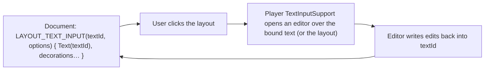

### TextInputLayout

`TextInputLayout` is a box whose content displays a document string that the user can edit. The layout
declares the string (`textId`) as editable and carries the options a platform editor needs: keyboard type,
IME action, input flags, maximum length, input filter, hint and content type. Its content is free: typically a text
component bound to the same string, possibly decorated with a label, an icon or a border, but any content
works.

#### Behavior

- When the layout is clicked (and no content handled the click) on a player that installed a
  `TextInputSupport` on its `PaintContext`, a `TextInputSession` starts and the host presents an editor.
  The session's bounds and text style come from the first `CoreText` in the content bound to `textId`,
  when there is one; otherwise the editor covers the whole layout with default styling.
- While the session is active, that text component is not painted (the editor shows the text); the rest of
  the content keeps painting. The layout reports bounds changes (scroll, relayout) to the host so the editor
  stays aligned.
- The host writes the user's edits back into the string with `TextInputSession.setText()`, on every keystroke
  by default or only on the IME action when the `COMMIT_ON_DONE` flag is set. Every binding on that string
  (text components, expressions, validators) updates through the usual listener mechanism.
- The host calls `TextInputSession.end()` when the editor is dismissed; the content renders normally again.
- When the string is empty and no editor is presented, the layout draws the `hintId` string at reduced
  opacity in place of the bound text (at the layout's content origin when there is no bound text).
- Without text input support the layout behaves like a box.

#### Fields

The component, animation and text ids are followed by a sparse attribute list (`count`, then byte attribute
id and int value pairs, defaults omitted). Unknown ids are reserved for future attributes.

| Field | Values |
| :--- | :--- |
| `componentId` | Component id |
| `animationId` | Animation id |
| `textId` | Id of the edited string data (`DATA_TEXT`). It must be a plain, mutable string, not an expression. |
| `keyboardType` (id `1`) | `0` unspecified, `1` text, `2` ascii, `3` number, `4` phone, `5` uri, `6` email, `7` password, `8` number password, `9` decimal (same values as Compose `KeyboardType`). The password types make the field secure: the editor masks the characters, is single line, and disables suggestions and copy. |
| `imeAction` (id `2`) | `0` none, `1` default, `2` go, `3` search, `4` send, `5` previous, `6` next, `7` done (same values as Compose `ImeAction`) |
| `inputFlags` (id `3`) | Bitmask: `1` single line, `2` commit on done, `4` auto correct, `8` capitalize characters, `16` capitalize words, `32` capitalize sentences |
| `maxLength` (id `4`) | Maximum number of characters, `0` for unlimited |
| `filter` (id `5`) | Input filter applied before a keystroke reaches the string: `0` none, `1` digits, `2` decimal, `3` alphanumeric, `4` hexadecimal |
| `hintId` (id `6`) | Id of the placeholder string shown when the text is empty, `0` for none |
| `contentType` (id `7`) | What the string holds, for autofill and keyboard suggestions: `0` none, `1` person name, `2` first name, `3` last name, `4` email address, `5` phone number, `6` username, `7` password, `8` new password, `9` one-time code, `10` postal address, `11` postal code, `12` credit card number, `13` credit card expiration date, `14` credit card security code |

#### Mapping to other platforms

The values coincide with Compose's `KeyboardType`, `ImeAction`, `KeyboardCapitalization` and `ContentType` for
convenience, but the protocol enums are RemoteCompose's own (`TextInputLayout.*`); every value has a direct
equivalent on the usual platforms, so non-Compose players map from these constants:

| Attribute | Android | iOS (`UITextInputTraits`) | Web |
| :--- | :--- | :--- | :--- |
| `keyboardType` | `InputType` | `keyboardType` (default, asciiCapable, numberPad, phonePad, URL, emailAddress, decimalPad); password variants set `isSecureTextEntry` | `inputmode` / `type` |
| `imeAction` | `imeOptions` | `returnKeyType` (`previous` has no equivalent: default) | `enterkeyhint` |
| capitalization flags | `TYPE_TEXT_FLAG_CAP_*` | `autocapitalizationType` | `autocapitalize` |
| auto correct flag | `TYPE_TEXT_FLAG_AUTO_CORRECT` | `autocorrectionType` | `spellcheck` |
| single line flag | single line | `UITextField` vs `UITextView` | `input` vs `textarea` |
| `maxLength`, `filter` | `InputFilter` | `shouldChangeCharactersIn` delegate | `maxlength` + input handler |
| `contentType` | autofill hints | `textContentType` | `autocomplete` |
